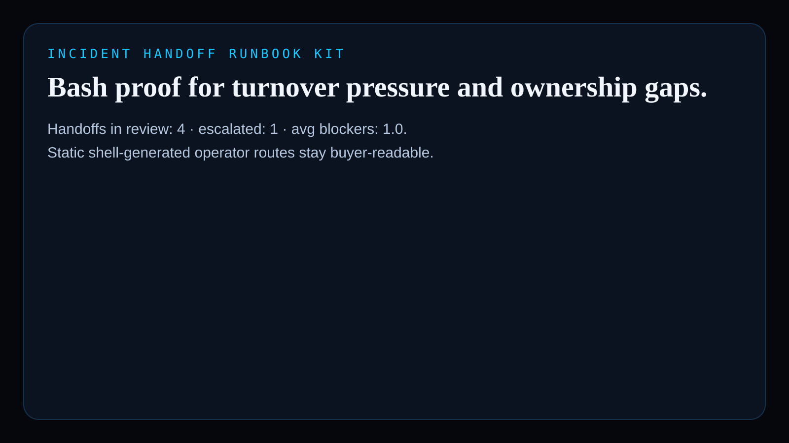
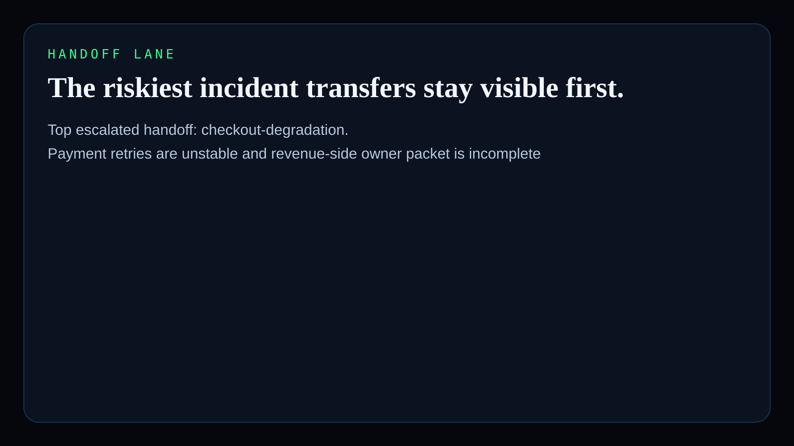
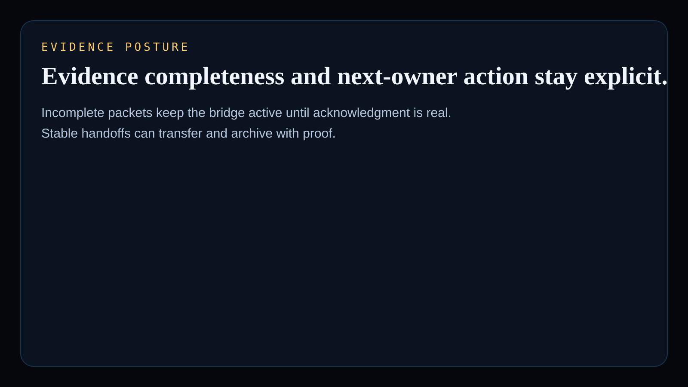
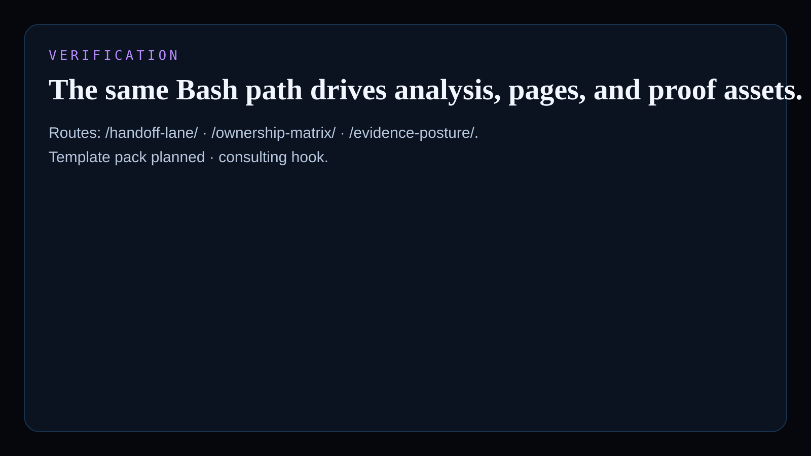

# incident-handoff-runbook-kit

Bash-native operator surface for SRE, Platform, Security, Support, and Revenue teams reviewing incident owner handoff pressure, evidence completeness, SLA drift, and next-step routing.

## Availability and scope (checked 2026-10-30)

This repository contains a local, synthetic demonstration. The shell script analyzes four hard-coded sample handoffs and generates static pages; it does not process live incidents or customer data. It is not an operational incident-management service.

The configured `runbook.kineticgain.com` domain did not resolve during the 2026-10-30 check. The GitHub Pages URL redirected to that domain, so neither URL provided a working public demo in that check. The repo is under retirement review, but no archive, redirect, or replacement has been approved. The `CNAME` and Pages configuration remain in place while incoming links and route behavior are assessed.

## What it shows

- real `Shell / Bash` added to the public Kinetic Gain language atlas with a second distinct primitive
- incident-handoff decisioning that comes from shell analysis, not a mocked dashboard
- monetizable runbook kits, handoff templates, and embedded incident-governance consulting hooks

## Screenshots






## Routes

- `/`
- `/handoff-lane/`
- `/ownership-matrix/`
- `/evidence-posture/`
- `/verification/`
- `/docs/`

## Local development

```powershell
bash scripts/run_demo.sh
bash scripts/generate_site.sh
```

## Validation

```powershell
bash test/runtests.sh
bash scripts/smoke_check.sh
bash scripts/render_readme_assets.sh
```

## Why this matters

Kinetic Gain Embedded tie-back:

The local Bash demo analyzes sample handoff pressure and generates operator-readable static routes. Those source capabilities may be reused in runbook kits or embedded incident-response work; the current public demo is unavailable as noted above.

## Commercial path

- `Template pack planned`
- `Consulting hook`

This can ladder into incident handoff packs, war-room turnover checklists, evidence routing kits, and embedded incident-governance work for platform and security teams.

---

Part of the [Kinetic Gain operator portfolio](https://kineticgain.com/) · docs: [suite.kineticgain.com](https://suite.kineticgain.com/)
